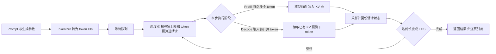

# MinivLLM Inference Lab

基于 [MinivLLM](https://github.com/Wenyueh/MinivLLM) 的 Qwen3 推理引擎复现与优化项目。技术主线是 **基础推理引擎 → KV Cache/调度扩展 → DFlash＋CUDA Graph → EAGLE-3/DFlash/DSpark 对照与消融 → 多 GPU 推理与 AWQ**。模型与 Draft 使用官方权重，本项目完成执行适配、状态管理及受控实验，没有自行训练投机模型。

代码围绕一份核心引擎组织，各实验保留独立配置和入口。主要优化与性能评测使用 A100-PCIE-40GB 和 Qwen3-8B；Qwen3-0.6B 用于早期基础推理、前缀缓存及分块调度的功能检查，未完成与 8B 同等范围的性能评测。所有性能结论都限定相应负载和比较对象。

## 代表性技术工作与实验结果

- **缓存与调度：** 扩展链式前缀复用、引用计数/LRU、Chunked Prefill 与混合调度。ShareGPT 派生 100 请求的四组统一 Decode-first 对照，各测三轮；启用 Prefix 相对 Full/Chunk-only 的配对吞吐分别 **+16.21% / +16.61%**，Chunk 的两组配对吞吐均下降。[四组正式报告](results/sharegpt/factorial-20261024/README.md)；旧三组单次测量的 **+20.23%** 单独保留为[历史结果](results/sharegpt/README.md)。
- **投机执行与方法对照：** 原 DFlash 路径实现多请求 Target 批量验证、连续前缀接受、KV 回滚与 Target Graph；新路径通过 `LegacyTarget` 保留官方三种 Draft 的提议/接受逻辑，比较方法及 DSpark 推理策略。两套口径见下表。
- **多 GPU：** 比较 Single/TP2/DP2/1P1D；双卡 DP2 对单卡的系统总吞吐 **+19%～26%**，每卡效率下降。1P1D 对 DP2 吞吐接近，最大 ITL **−89%～90%**，P99 未全面改善；TP2 显存约减半，但更慢且完整生成仅 47/48 一致。[正式报告](results/distributed/README.md)
- **AWQ：** 官方 W4A16 权重适配与 Triton 量化 GEMM，权重及量化元数据存储 **−62.77%**；该比例不是整个运行峰值显存降幅，所测推理未加速。[正式报告](results/awq/README.md)

### 两套投机实验分别证明什么

| 实验 | Draft 与候选预算 | 执行与负载 | 基线与代表结果 |
|---|---|---|---|
| [A 原 DFlash＋Target Graph](results/dflash_graph/README.md) | 官方 z-lab b16，15 个候选＋Pending | Target 支持多请求 Batched Verification；单请求、驻留≤2 的三请求；每请求 256 输出，四模式各三轮 | 相对 **AR Graph**，总输出吞吐 **2.99× / 1.52×**；输出与接受轨迹一致，正式 Target 验证 `fallback=0` |
| [B EAGLE-3/DFlash/DSpark 对照](results/speculative_compare/legacy-target-formal-20261021/README.md) | 官方 DeepSpec 三种 Draft，最多 7 个候选＋Pending | 统一 Mini-vLLM Qwen3-8B Target **Eager**；Batch=1，无 Graph；十二条输入，每条 256 输出，三轮 | 相对配对 **AR Eager**，EAGLE-3 **2.93×**、DFlash **3.48×**、DSpark Markov Only **3.90×**、Fixed **3.89×**；七种投机配置共 **252/252** 完整输出一致 |

两组时间均包含 Prefill 与完整生成。A 是固定单请求/三请求负载，B 是 GSM8K/HumanEval/MT-Bench 各四条输入的串行对照；Draft、候选预算、执行配置与软件环境不同，不能横向归因或相乘加速比。B 的固定算术参考 AR Eager 也不代表生产最优 AR 性能。三种 checkpoint 属于方法对照，同一 DSpark checkpoint 的开关才是推理消融。

**DSpark 的发现：** 开启 Markov 后配对吞吐 **+84.68%**。Confidence 是辅助选择送验前缀长度的预测分数；阈值 0.5/0.8 相对 Fixed，配对吞吐反而 **−1.97% / −18.16%**。0.8 的送验候选接受率更高，但实际输出/验证从 4.826 降到 3.873，需要更多 Draft/Target 轮次。这里只评估 Batch=1 固定阈值，不能否定高并发负载感知调度。[完整消融分析](results/speculative_compare/legacy-target-formal-20261021/README.md#dspark-消融说明)

Fixed 吞吐中位数为 **63.225 tokens/s**，略高于 Markov Only 的 **63.180**；后者的配对加速比中位数却略高（3.898× 对 3.894×）。配对比值中位数与吞吐中位数是不同统计量，本轮两者输出和接受轨迹相同，微小差值不足以判定稳定优劣。

快速导航：[文档入口](docs/README.zh.md) · [项目事实总览](docs/PROJECT_SUMMARY.zh.md) · [简历描述](docs/RESUME.zh.md) · [面试讲述与问答](docs/INTERVIEW.zh.md) · [原 DFlash＋Graph](results/dflash_graph/README.md) · [三方法与消融](results/speculative_compare/legacy-target-formal-20261021/README.md) · [原始数值诊断](results/speculative_compare/diagnostic-20261019/README.md)

## 从这里开始学习

这个项目研究的是 **LLM 推理系统**：如何把已训练好的 Qwen 权重变成能管理多条请求、复用 KV、减少解码开销的执行引擎。重点是计算、显存和请求调度，不涉及模型预训练。

建议先读本页的流程图，再按 [源码学习指南](docs/LEARNING_GUIDE.zh.md) 阅读关键函数；需要准备项目介绍时看 [面试讲解与问答](docs/INTERVIEW.zh.md)。完整指标及局限在 [项目总结](docs/PROJECT_SUMMARY.zh.md)，操作命令在 [复现说明](docs/REPRODUCE.zh.md)。

阅读代码和基础 CPU 合约检查不需要租 GPU：克隆后执行 `python3 scripts/check_cpu.py` 即可。真实模型速度、CUDA Graph 和 NCCL 结果需要对应 GPU 环境复现。

### 一条请求如何生成答案



Prefill 处理输入上下文并建立 KV；Decode 反复使用历史 KV 生成输出。调度器决定本轮谁执行、执行多少 token，模型负责计算，块管理器负责物理页与请求的逻辑映射。部分 Prefill 只更新 KV，处理到完整 prompt 末尾时才采样。

### 各项优化分别解决什么

| 技术 | 解决的问题 | 本项目主要代码 |
|---|---|---|
| Paged KV Cache | 请求长度动态增长，连续大块缓存难分配 | [block_manager.py](src/myvllm/engine/block_manager.py)、[attention.py](src/myvllm/layers/attention.py) |
| Prefix Cache 与 LRU | 相同完整前缀反复计算，占用有限缓存 | [block_manager.py](src/myvllm/engine/block_manager.py) |
| Continuous Batching | 等整批完成才接新请求会浪费空位 | [scheduler.py](src/myvllm/engine/scheduler.py) |
| Chunked Prefill | 长 prompt 的一次 Prefill 阻塞正在生成的请求 | [chunk_scheduler.py](src/myvllm/engine/chunk_scheduler.py)、[chunk_runtime.py](src/myvllm/engine/chunk_runtime.py) |
| CUDA Graph | Decode/批量验证的许多 GPU 操作反复由 CPU 提交 | [graph_executor.py](experiments/dflash_graph/graph_executor.py) |
| DFlash | 普通解码每轮只推进一个 token，Target 前向次数多 | [dflash_runtime.py](experiments/dflash_graph/dflash_runtime.py)、[state.py](experiments/dflash_graph/state.py) |
| AWQ W4A16 | 模型权重存储大 | [awq_linear.py](experiments/awq/awq_linear.py)、[awq_loader.py](experiments/awq/awq_loader.py) |
| TP / DP / 1P1D | 模型按设备拆分、请求扩展、Prefill 与 Decode 干扰 | [target.py](experiments/common/target.py)、[distributed](experiments/distributed/runtime.py) |

这些技术优化的对象不同。缓存命中可以减少 Prefill 工作；Graph 减少提交开销；投机解码减少昂贵 Target 调用；DP 通过增加完整副本扩展总吞吐；PD 让两类计算分别占用设备。是否更快取决于负载、实现和硬件，结果表也保留了未加速的配置。

### 仓库中的执行路径

| 路径 | 调用链 | 适合先理解什么 |
|---|---|---|
| 普通引擎与调度 | `LLMEngine → Scheduler/ChunkScheduler → ModelRunner` | 请求生命周期、分页 KV、Prefix、Chunk；ShareGPT 使用独立参考算术适配 |
| DFlash＋Graph | `GraphDFlashRuntime → TargetGraphExecutor → Target.model` | 草稿、批量验证、接受/回滚、静态图输入；独占自己的 KV，不调用普通 `engine.step()` |
| 多卡实验 | `run_load → Session → torchrun worker → Target` | DP 路由、TP 组、真实 NCCL KV 迁移、P/D 两端职责 |
| 三种 Draft 对照 | `DeepSpec evaluator → LegacyTarget → TargetGraphExecutor eager` | 官方提议/接受循环、原 Target 适配、Markov/Confidence 消融；串行 Batch=1，无 Graph |

共享 `src/myvllm` 和数值/加载工具，各实验路径保留明确配置。仓库没有把所有开关合并成一个经过验证的生产服务。

根目录 `main.py` 保留历史引擎的基础配置供实验导入；复现实验使用 `scripts/run.py`，不要把旧 demo 默认参数当成完整实验配置。

### 建议把学习重点放在哪里

1. **先读请求和缓存。** 能画出一次 Prefill、两次 Decode 的 token 数、逻辑位置、物理页和释放时机。
2. **再读 DFlash＋Graph。** 重点解释为什么要用 AR Graph 作基线、拒绝后回滚哪些状态、图回放时怎样更新元数据。
3. **接着读三种 Draft 与消融。** 区分方法对照与同 checkpoint 开关，解释 Markov、Confidence 和接受率/推进长度；再读 Target 数值排查。
4. **最后读 DP 与 1P1D。** 能讲清请求分配、KV 打包/迁移/重映射，以及为什么最大 ITL 改善不等于吞吐提升。

AWQ 和 TP 可以作为内存与并行的补充案例。算子 benchmark 是局部检查；正式模型路径、数值一致性与端到端收益要分别讨论。具体阅读函数、练习和验收问题见 [学习指南](docs/LEARNING_GUIDE.zh.md)。

## 目录

```text
src/myvllm/             核心模型、算子、KV 管理和调度
experiments/common/    共享加载、固定计算形状和复现工具
experiments/dflash_graph/   AR / DFlash × eager / Graph 四项对照
experiments/speculative_compare/  EAGLE3 / DFlash / DSpark 对照与原 Target 适配（正式一致性已通过）
experiments/distributed/    single / TP2 / DP2 / 1P1D 对照
experiments/sharegpt/       固定 ShareGPT 派生 100 请求调度对照
experiments/awq/            W4A16 权重加载、量化算子与基线
experiments/prefix/         Prefix Cache 与 LRU 验证
experiments/chunked/        Chunked P/D 与 Prefix 组合验证
benchmarks/            Prefill / Decode 算子测试
scripts/               模型和数据准备、统一启动、CPU 检查
data/                  版本、样本选择哈希和参考输出
results/               精选指标与原始记录 SHA256
docs/                  复现说明、项目总结、简历项目经历
```

## 安装与运行

已完成的 [ShareGPT 四组消融](results/sharegpt/factorial-20261024/README.md) 增加 Prefix-only，统一 Decode-first 并禁止 Full 隐式分块；四组各三轮通过输出一致性、历史参考、干净计时和页回收检查。独立入口为 `python scripts/run.py sharegpt-factorial`，默认各三轮；旧三组结果保持独立。[复现与迁移说明](docs/SHAREGPT_FACTORIAL.zh.md)。

以下原引擎实验环境为 Linux、Python 3.11、NVIDIA GPU；实测 PyTorch 2.9.1+cu128、Triton 3.5.1、Transformers 4.57.3。双卡实验要求同机两张 GPU。新三种 Draft 对照另用 Transformers 5.10.2 的独立环境与[适配入口](experiments/speculative_compare/LEGACY_TARGET.zh.md)，不直接套用以下安装步骤。无需安装 vLLM。

```bash
git clone https://github.com/qingzhai/mini-vLLM.git
cd mini-vLLM
python3.11 -m venv .venv
source .venv/bin/activate
pip install -r requirements-gpu.txt
pip install -e . --no-deps

# 模型和结果放在 Git 仓库之外。已有 AutoDL 目录可直接复用。
export WORK_ROOT="$HOME/autodl-tmp/minivllm-work"
export HF_ENDPOINT=https://hf-mirror.com
python scripts/download_models.py Qwen3-8B
python scripts/download_models.py Qwen3-8B-DFlash-b16

python scripts/run.py dflash-graph
```

已有模型和 venv 时只需激活环境、设置 `WORK_ROOT` 后运行入口。首次新下载基础模型会记录解析出的 commit，并核对历史 tokenizer/config 哈希；历史基础模型完整 checkpoint commit 未被归档，详见 [复现说明](docs/REPRODUCE.zh.md)。AWQ 和 Draft 使用已记录的固定 revision。

其他实验：

```bash
python scripts/prepare_workload.py
python scripts/run.py sharegpt
python scripts/run.py distributed

python scripts/download_models.py Qwen3-8B-AWQ
python scripts/run.py awq
python scripts/run.py prefix
python scripts/run.py chunked
python scripts/run.py decode -- --batch-sizes 1 --seq-lens 128 --iters 10 --warmup 3
```

每次运行创建新的结果目录，保存配置、日志和完整源码，再生成 records ZIP；不包含模型或环境。使用 `--dry-run` 查看命令而不调用 GPU。CPU 验证：`python scripts/check_cpu.py`；包含 CPU Torch 合约测试：`python scripts/check_cpu.py --tensor`。

新增 [EAGLE3 / DFlash / DSpark 对照](experiments/speculative_compare/README.md) 使用独立 DeepSpec 环境，官方 Draft 接入原 Mini-vLLM 稳定 Target。它按 Batch=1 串行执行，没有进入普通 Serving 调度器，也没有开启 Graph。原 HF BF16 / FP32 Head / HF FP16 的失败与诊断均保留，不能把最后通过解释成所有历史分叉已完成单因素归因。

全部七种模式、配对基线、原始 Token 与离线复算见[正式报告](results/speculative_compare/legacy-target-formal-20261021/README.md)，运行协议见 [Target 适配说明](experiments/speculative_compare/LEGACY_TARGET.zh.md)。旧 ShareGPT 三组与多卡每配置仅单次正式测量；新 ShareGPT 四组、Graph 与三方法对照各测三轮，不能把测量次数混用。

## 实验范围

正式跨模式正确性使用全阶段 per-query PagedAttention 和固定算术参考配置。原 Flash Prefill 的小规模算子检查不能替代完整模型正确性，相关数值分叉没有被本项目结果证明全部修复。DFlash Graph 仅覆盖 Target 前向，Draft 和初始 Prefill 在图外。TP2 按相同历史 logits 容差验收，自由生成一致率另列；量化尚无任务质量评测。没有验证所有功能同时启用。

发布整理保留了既有实验的路径、共用文件和启动方式；CPU 检查覆盖目录迁移和状态合约。2026-10-24 新增的 ShareGPT 四组路径已完成 GPU 正式测量与本地归档审查；其他历史路径未因本次整理而重新跑 GPU。性能数字均对应各自归档源码。

## 来源与项目经历

保留 Apache-2.0 [LICENSE](LICENSE)；第三方代码、模型和数据来源见 [THIRD_PARTY_NOTICES](THIRD_PARTY_NOTICES.md)。[项目经历](docs/RESUME.zh.md) 使用已测结果，可用于个人简历。
